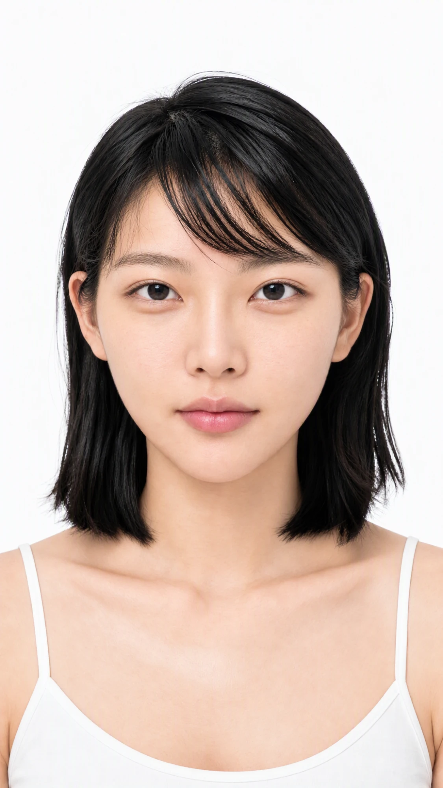
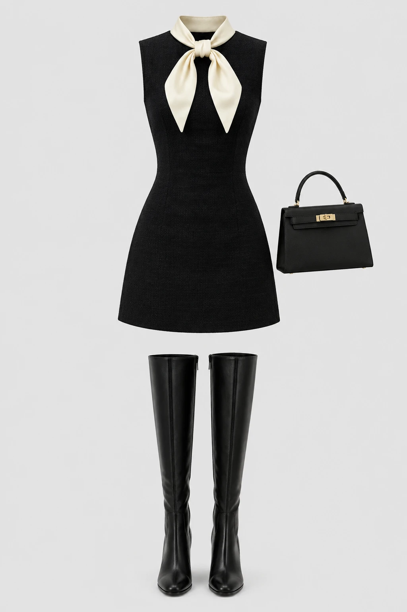
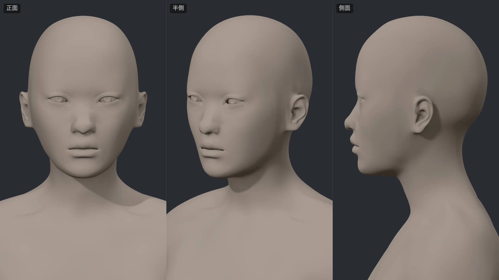
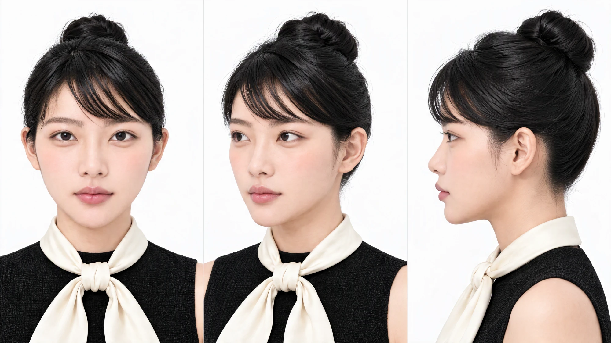
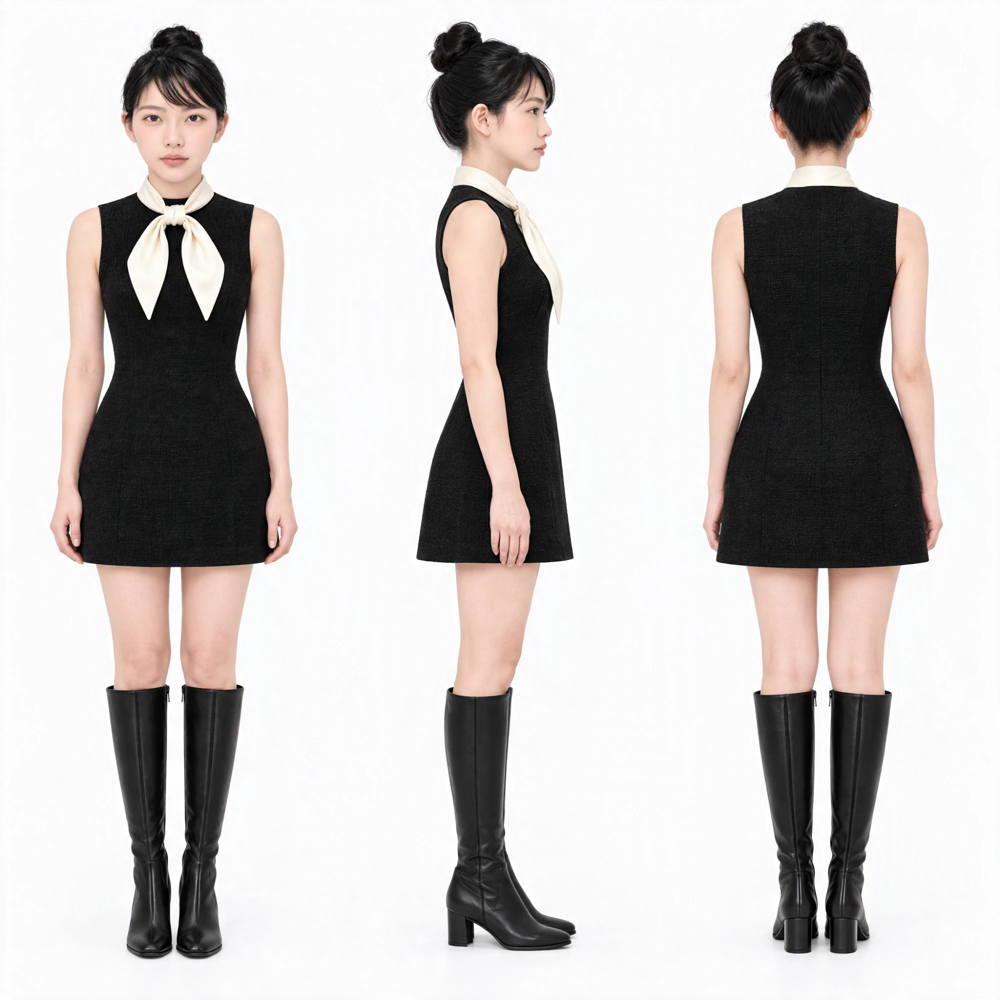
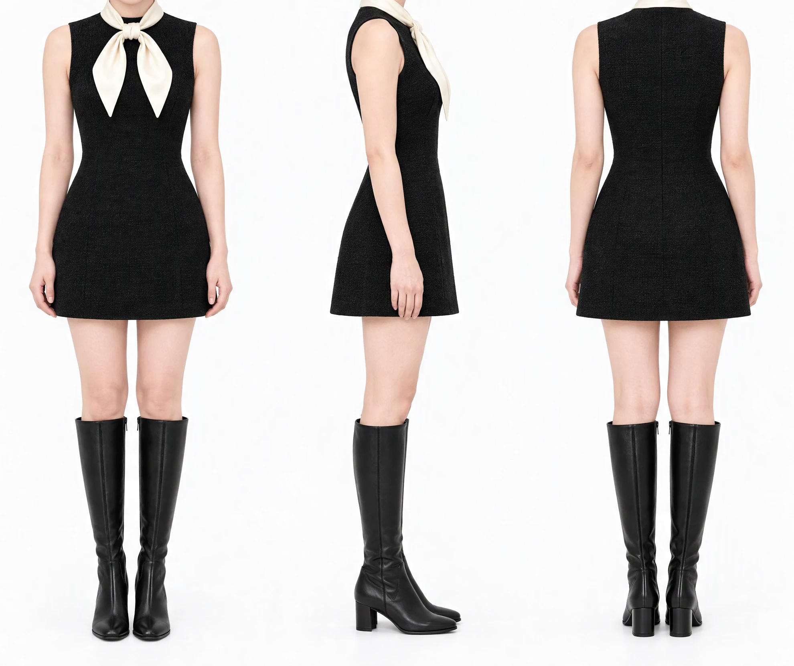

做 AI 影片的人大概都遇過這種事：角色的臉好不容易穩住了，一換衣服就走樣。用文字描述服裝，「黑色無袖洋裝、領口繫奶白色絲巾」，每次生出來的布料、裙長、絲巾綁法都不一樣；拿網路上的穿搭照當參考，又會連照片裡那個人的臉、體型一起帶進來。

2026 年 10 月底，網路上一口氣冒出一批網站，專門收集 AI 生成的服裝、姿勢和臉孔。服裝是一整套沒有人穿的衣服，姿勢是沒有臉的灰色人台，臉孔是不存在的虛構人物。挑一件衣服、一個姿勢、一張臉，一起丟給圖像模型，說一句「換上這件」就好。對 AI 角色來說，等於多了一座免費衣櫥。

這篇分兩部分。前半整理這些網站：源頭在哪裡、中文圈衍生出哪些整合站、哪幾個授權最乾淨，以及「免費」其實有三種不同的意思。後半是我自己做的一個小案例：從一張角色臉開始，在圖庫挑一套衣服換上，做出四種設定圖，最後交給 Seedance 生成一支 20 秒的影片。

> 本文的星數、圖片數量為 2026 年 11 月 23 日查詢的數字，這些專案仍在快速更新。各圖庫的授權條款以原站當下的說明為準，本文只是整理，不構成法律意見。

## 一、衣櫥裡有什麼：三種參考圖

這類網站收的參考圖大致分成三種：

- **服裝**：沒有人穿的整套衣服，通常是 2:3 直式、純色背景，上衣、下身、鞋子、包包一次排好。因為畫面裡沒有人，丟給模型時不會連帶改掉角色的臉和身形，也不用先摳圖。
- **姿勢**：沒有五官的灰色人台，同一個姿勢從正面、斜側、側面、俯視、仰視等角度各畫一張，有的另外附深度圖，可以直接接 ControlNet。
- **臉孔**：AI 生成的虛構人物，以白底正面的大頭照為主，用來當角色的「定妝照」，讓同一個角色在每張圖裡長得一樣。

三種一起用的邏輯，RuiC-PoseAtlas 的說明寫得最精準：「姿勢定骨架，衣裝定皮相，人像定臉」。

這類圖庫會在今年突然紅起來，編輯部的觀察是：多圖參考的圖像編輯模型（GPT Image、Nano Banana、Qwen-Image-Edit、Seedream 等）已經能分辨「這張取臉、那張取衣服、第三張取姿勢」。參考圖本身成了一種素材，而在這之前，很少有人專門為了「給 AI 看」去生成一整套乾淨的參考圖。

## 二、源頭：日本兩位創作者的資料庫

這一波幾乎都能追到同一個源頭：日本「AI 美女」圖像圈的創作者ギア（@giaaibusi）與あぎ（@agi_aibusi），把自己生成的參考圖整理成資料庫，免費放在 Cloudflare Pages 上。

| 圖庫 | 作者 | 內容 | 數量 | 公開時間 |
| --- | --- | --- | --- | --- |
| [AIモデル顔データベース](https://ai-portrait-gallery.pages.dev/) | あぎ | 正面臉部＋帶服裝的造型照，可依髮長篩選 | 1,499 張 | 10 月 22 日 |
| [ポーズ集 POSE-DB-01](https://ai-pose-gallery.pages.dev/) | ギア | 無臉灰色人台線稿，5 個角度 | 288 組／1,439 張 | 10 月 27 日前後 |
| [衣装集 COSTUME-DB-01](https://ai-costume-gallery.pages.dev/) | ギア | 沒有人物的整套服裝，分 8 類 | 1,407 套 | 10 月 29 日 |
| [depthポーズ集 POSE-DB-02](https://ai-pose-depth-gallery.pages.dev/) | ギア | 同一批姿勢的深度圖 | 1,439 張 | 10 月 30 日 |
| [衣装集 アニメ版](https://ai-costume-anime-gallery.pages.dev/) | ギア | 動漫風服裝 | 1,320 套 | 11 月 2 日 |
| [キャラ組み立てDB](https://charadb-2fi.pages.dev/) | たき AI | 二次元髮型、眼睛、服裝、姿勢 | 1,027 張 | 11 月初 |

公開時間依作者在 X 上的發布貼文推算。服裝集的 8 個分類是春、夏、秋、冬、內衣、派對、泳裝和性感；臉庫是用 Midjourney 生成後，只把臉的部分整理出來。

要提醒的一點：這幾個圖庫出身於成人取向的社群。姿勢庫最大的分類是性感系，另外還有雙人體位類，站上也把人導向討論「無審查 AI」用法的 LINE 群組。後來的中文整合站多半加了安全模式或 18 歲以上的提示。在課堂或公開場合示範之前，最好先自己看過一輪。

## 三、中文圈的整合站：翻譯、合併、接上生圖

日本原站公開後不到一週，中文圈就在 GitHub 上做出十幾個衍生版本。主要的幾個：

| 站 | GitHub 星數 | 特色 |
| --- | --- | --- |
| [anhao/ai-pose-gallery-zh](https://github.com/anhao/ai-pose-gallery-zh)（[線上版](https://ai-pose-gallery.anhao.app/)） | 7,882 | 三庫合一、全中文化，內建生圖工作台，也能當 ComfyUI 節點 |
| [RuiC-PoseAtlas](https://github.com/HRuiCcc/RuiC-PoseAtlas) | 1,815 | 中英日三語、純靜態，只做檢索、不接生圖 |
| [omilic.com](https://omilic.com/)（[原始碼](https://github.com/hongye007/open-pose-costume)） | 854 | 姿勢 343 組、服裝 2,821 套、人物 1,539 張，含自建素材，可一鍵生圖 |
| [拍片哥 nvzhuang](https://github.com/paipiange/nvzhuang) | 2,971 | 1,407 套女裝＋虛擬試穿 |
| [photoai.life](https://photoai.life/) | — | 中日雙語入口，逐庫標出授權 |

anhao 版的生圖工作台可以直連 Gemini、GPT Image、阿里雲百煉、火山方舟與本機 ComfyUI，另外收進 CharaDB 與 Shisei 的服裝；omilic 則有配套的 Codex skill。

這些整合站做的事大同小異：把分散的三個日文站合在一起、補上中文搜尋，再接上生圖 API 或 ComfyUI。好處是檢索方便很多，問題出在圖片本身。日本原站的條款禁止再散布與轉載，不少整合站卻把原圖整包放上 GitHub，或另外提供網盤打包下載。在我們查到的整合站裡，只有 omilic 在文件中寫明取得了原作者的額外授權，但那是維護者的自述，外人無從查證。ギア後來也在站上加了一條：禁止用工具一次大量下載，取得的圖片同樣不得再散布。

## 四、自己重新生成、授權最乾淨的兩個

如果作品要公開、要接案，這兩個是目前授權寫得最清楚的：

- **[Shisei 姿勢](https://shisei.indaloop.app/en/)**：照著ギア姿勢庫的「清單」，自己重新生成全部的圖。280 個姿勢、1,212 張通過檢查的線稿，另有 clay、深度與法線圖共 944 張。**圖片以 CC0 釋出，可以商用、也可以再散布**，姿勢名稱有日、中、英、韓四種語言，性感與雙人系列預設模糊處理。另收有一批中國歷代服裝。
- **[WaveSpeed AI](https://wavespeed.ai/free-tools/ai-character-builder)**：生成服務商自己做的三套圖庫，[臉孔 284 張](https://wavespeed.ai/free-tools/ai-face-gallery)、[姿勢 491 組／2,946 張](https://wavespeed.ai/free-tools/ai-pose-templates)、[服裝 300 套](https://wavespeed.ai/free-tools/ai-outfit-gallery)，服裝有正面與背面兩張。瀏覽和下載不用註冊，站方聲明可用於個人與商業作品，只是不能把姿勢圖單獨打包轉售。Character Builder 可以把臉、衣服、姿勢三選一組合後送進它自家的生圖器，這一步才需要帳號與點數，說穿了是導流用的。

## 五、怎麼挑：依用途對照

| 你要做的事 | 建議先看 | 原因 |
| --- | --- | --- |
| 正式作品、會公開或商用 | 服裝：WaveSpeed／臉：あぎ臉庫／姿勢：Shisei | 授權最明確，可商用 |
| 找靈感、快速試搭 | omilic、anhao 版 | 搜尋與篩選最方便，可直接試生成 |
| 在 ComfyUI 裡串工作流 | anhao 版、Shisei | 前者內建節點，後者有深度與法線圖 |
| 需要 ControlNet 深度圖 | ギア depth 集、Shisei | 同一個姿勢附五個角度的深度圖 |
| 做二次元角色 | CharaDB、ギア動漫衣装 | 畫風一致，CharaDB 附 Danbooru 標籤 |

## 六、「免費」有三種意思

這批圖庫都標榜免費，但寫在條款裡的範圍差很多，大致可以分成三級：

1. **CC0，近乎沒有限制**：あぎ臉庫、Shisei 的圖片。可以商用、編輯、拿去當參考。あぎ另外「拜託」大家不要轉載原圖檔，這是請求而不是授權條件。
2. **作品可以商用，原圖不能拿去散布或轉賣**：ギア的姿勢、服裝、深度圖各庫，拿來生成你自己的作品沒問題，但原圖（包括加工過的版本）不能再散布、轉載或販售；WaveSpeed 則是不能把圖單獨打包轉售。
3. **只限個人非商用，連衍生圖都管**：omilic 的自建素材。條款寫明只能個人學習與非商用，原圖、修改圖、用它生成的衍生圖，未經書面授權都不能放到其他網站、倉庫或資料集。

所以有兩件事要記得。第一，從整合站或網盤包拿到的圖，授權不會因此變寬，最好回到原站取用；第二，作品要公開之前，先回頭確認那件衣服是從哪個庫、哪一級授權來的。下面這個案例，剛好就踩在第三級。

## 七、實作：一套衣服，從挑選到上片

以下是我（黃宏瑞）用自己的角色走過一次的完整流程。繪圖全程使用 GPT Image 的 gpt-image 2.5 sunburst，影片使用 Seedance 2.5。

### 步驟一：一張角色臉

起點只有一張臉。白底、正面、表情放鬆、肩頸入鏡，穿著盡量單純，讓模型只從這張圖讀到「這個人長什麼樣子」。這也是前面那些臉庫的格式，如果還沒有自己的角色，直接從あぎ臉庫挑一張也可以。

### 步驟二：從圖庫挑一套衣服

衣服是在 [omilic](https://omilic.com/) 的服裝庫挑的：編號 ST-003「黑色無袖裙與奶白絲巾」，歸在[秋日穿搭類](https://omilic.com/?view=costume&category=autumn)。黑色粗花呢無袖短洋裝、領口打結的奶白絲巾、黑色手提包和及膝長靴，一整套排在同一張圖上。

omilic 在這套服裝的資料裡註明，它是從使用者提供的街拍照片用 AI 提取、重新繪製的，被遮住的部分由 AI 推斷。也因為它是 omilic 的自建素材，屬於上一節說的第三級授權：只限個人非商用，衍生圖也不能未經授權轉載。本文刊出這張服裝原圖，是為了評論與教學，在必要範圍內引用並註明出處；後面的設定圖與影片，則是我以這套衣服的款式為參考、自己重新生成的。維護者若認為不妥，歡迎[來信](/contact/)，我們會撤下相關圖片。

### 步驟三：做設定圖

拿到臉和衣服之後，我沒有直接生影片，而是先做四種設定圖：定妝、頭部三視圖、全身三視圖，以及去掉頭部的全身三視圖。

**定妝與頭部三視圖**。定妝這一步，把髮型從及肩中短髮改成高丸子頭、留下空氣瀏海，配這套衣服更俐落。頭部轉角度時最容易「變臉」，所以三個角度我先用一個 3D 頭部灰模定好，再讓模型照著這三個角度，畫出定妝後的正面、半側、側面。

**全身三視圖**。接著把角色和衣服合在一起，畫出正面、側面、背面的全身站姿。這一張要確認的是衣服本身：裙長、絲巾怎麼垂、靴子的跟高，以及背面的丸子頭和洋裝背後長什麼樣子。服裝原圖只有正面，背面的細節就是在這一步定下來的。手提包沒有放進全身三視圖。

**去掉頭部的全身三視圖**。最後把全身三視圖的頭部裁掉，只留下脖子以下。這樣一來，影片模型讀到的臉，只會來自那張解析度高得多的頭部三視圖；全身圖只負責交代衣服和身形，兩張參考圖不會在「臉長什麼樣子」這件事上互相打架。

### 步驟四：兩張設定圖交給 Seedance

最後交給 Seedance 2.5 的，是頭部三視圖和去頭的全身三視圖這兩張。生成結果是一支 20 秒的影片：

<figure>
<video controls playsinline preload="metadata" width="1280" height="720" poster="/media/posts/ai-character-free-wardrobe/seedance-final-poster.jpg">
<source src="/media/posts/ai-character-free-wardrobe/seedance-final.mp4" type="video/mp4">
</video>
<figcaption>以 Seedance 2.5 生成的成片（20 秒，1280×720，有聲）。參考圖為頭部三視圖與去頭的全身三視圖。</figcaption>
</figure>

鏡頭從背後跟著她推開玻璃門、走上夕陽下的頂樓，她轉身整理絲巾，對著鏡頭微笑；中段她伸手遮住鏡頭轉場，接著是側臉特寫，最後從背後看她走下一段長長的石階，路旁是黃了的樹。整支看起來像一鏡到底的手持跟拍。

這支片裡，設定圖派上用場的地方很明顯：背影的丸子頭、側臉的輪廓、絲巾的綁法和垂墜，以及走下石階時的長靴，都對得上三視圖。這些角度是正面臉圖和正面服裝圖裡原本沒有的資訊。

### 做完的幾點心得

- **衣服圖越乾淨越好用**。沒有人穿的服裝圖不用摳圖，也不會把別人的臉和身材帶進來，這是這類圖庫最大的價值。
- **三視圖是給影片模型的「轉身依據」**。影片裡角色一定會轉身、走遠、換角度，正面圖給不了的資訊，要先在設定圖裡補齊。
- **臉和身體分開交代**。頭部用高解析的三視圖，全身圖去掉頭部，讓每張參考圖只負責一件事。
- **授權在挑衣服那一步就要看**。等作品做完才發現那件衣服只限非商用，就得回頭重來，或另外去要授權。

## 常見問題

**AI 生成的服裝參考圖可以商用嗎？**

**答**：看來源。あぎ臉庫與 Shisei 的圖片是 CC0，可以商用；ギア的姿勢與服裝庫允許用在自己的商業作品裡，但原圖不能再散布或販售，WaveSpeed 則是不能把圖單獨打包轉售；omilic 的自建素材只限個人非商用，連用它生成的衍生圖都不能未經授權轉載。整合站或網盤包裡的圖，授權不會比原站更寬。

**為什麼要用沒有人穿的服裝圖，而不是直接用穿搭照？**

**答**：穿搭照裡有另一個人的臉、髮型和體型，丟給模型時很容易一起被帶進來，還得先摳圖。沒有人物的服裝圖只提供衣服本身，模型比較能把它「換」到你的角色身上，也比較不會碰到真人肖像的問題。

**生成影片前一定要做三視圖嗎？**

**答**：不是一定，但角色只要會轉身、走遠或換角度，三視圖就很有幫助。正面臉圖和正面服裝圖沒有側面與背面的資訊，影片模型只能自己猜；先把頭部與全身的正、側、背定下來，轉身時髮型和衣服比較不會走樣。

**去掉頭部的全身三視圖有什麼用？**

**答**：讓臉部資訊只來自一張參考圖。全身三視圖裡的臉很小、細節少，如果和高解析的頭部三視圖一起給影片模型，等於同一張臉給了兩個版本；把全身圖的頭裁掉，它就只負責交代衣服與身形。

---

### 資料來源

- 日本原站：[AIモデル顔データベース](https://ai-portrait-gallery.pages.dev/)（あぎ）、[ポーズ集 POSE-DB-01](https://ai-pose-gallery.pages.dev/)、[depthポーズ集 POSE-DB-02](https://ai-pose-depth-gallery.pages.dev/)、[衣装集 COSTUME-DB-01](https://ai-costume-gallery.pages.dev/)、[衣装集 アニメ版](https://ai-costume-anime-gallery.pages.dev/)（ギア）、[キャラ組み立てDB](https://charadb-2fi.pages.dev/)（たき AI）；發布貼文：[あぎ 臉庫](https://x.com/agi_aibusi/status/2113187798220181839)（2026-10-22）、[ギア 衣装集](https://x.com/giaaibusi/status/2115639855178989745)（2026-10-29）、[ギア depth 集](https://x.com/giaaibusi/status/2116005476496494757)（2026-10-30）、[ギア アニメ衣装](https://x.com/giaaibusi/status/2117089256015622274)（2026-11-02）
- 中文整合站：[anhao/ai-pose-gallery-zh](https://github.com/anhao/ai-pose-gallery-zh)、[RuiC-PoseAtlas](https://github.com/HRuiCcc/RuiC-PoseAtlas)、[omilic（open-pose-costume）](https://github.com/hongye007/open-pose-costume) 與其[來源說明](https://github.com/hongye007/open-pose-costume/blob/main/SOURCES.md)、[自建素材使用條款](https://github.com/hongye007/open-pose-costume/blob/main/public/custom/LICENSE.txt)、[拍片哥 nvzhuang](https://github.com/paipiange/nvzhuang)、[photoai.life](https://photoai.life/)
- 重新生成的圖庫：[Shisei（wquguru/shisei）](https://github.com/wquguru/shisei)、[WaveSpeed AI Character Builder](https://wavespeed.ai/free-tools/ai-character-builder)
- 報導：[人人都是產品經理〈找姿勢、挑穿搭、定角色臉：這個零依賴開源圖庫，把 4345 張視覺參考裝進了一個網頁〉](https://www.woshipm.com/ai/6488179.html)、[要有 AI〈4 天 4 千星的中文 AI 姿勢庫〉](https://www.yaoyouai.cn/tutorial/411/ai-pose-gallery-zh/)、[香港01〈AI 影片經常變臉？日本免費圖庫實測〉](https://global.hk01.com/实用教学/60412538/ai影片经常变脸-日本免费图库实测-直接下载近1500张可商用png)、[e-zone〈AI 創作必備神器 免費參考圖庫收錄近 6000 個姿勢與穿搭〉](https://ezone.hk/article/20116861/)
