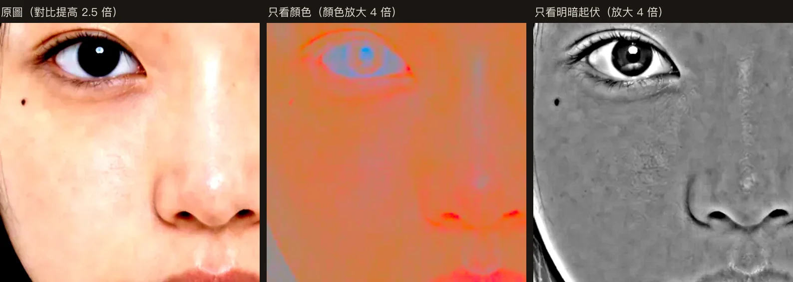
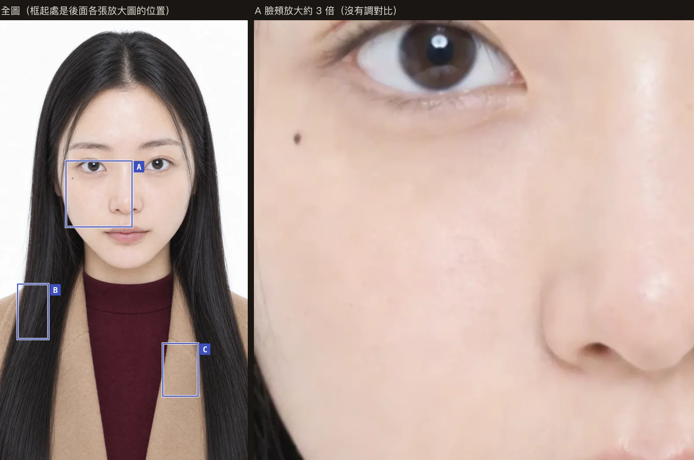
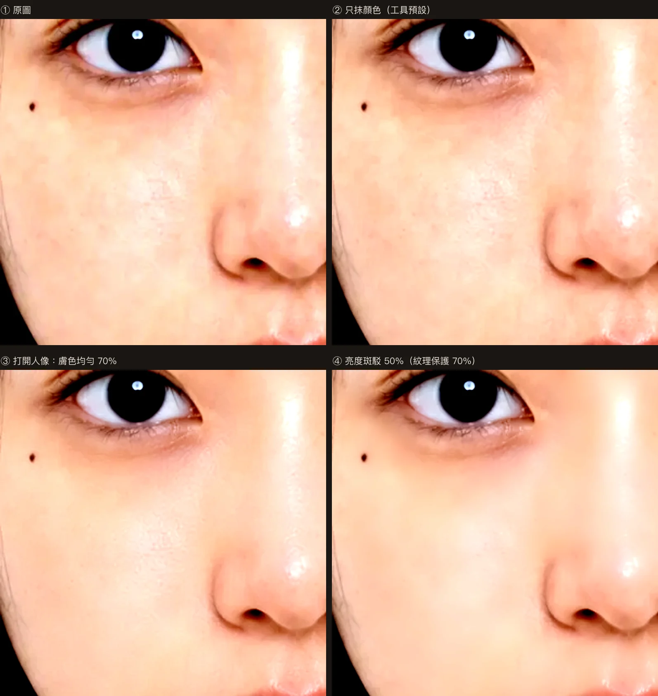
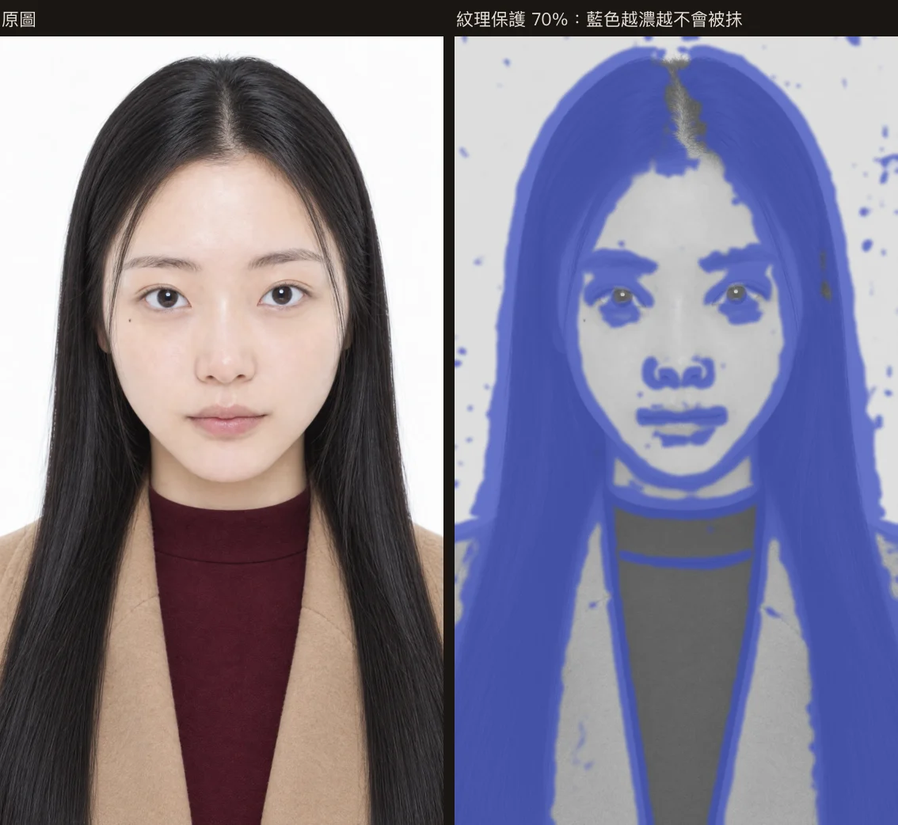
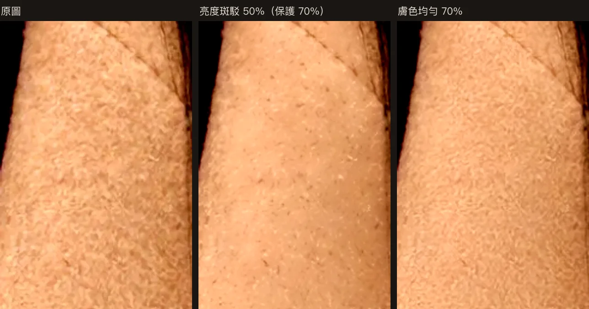
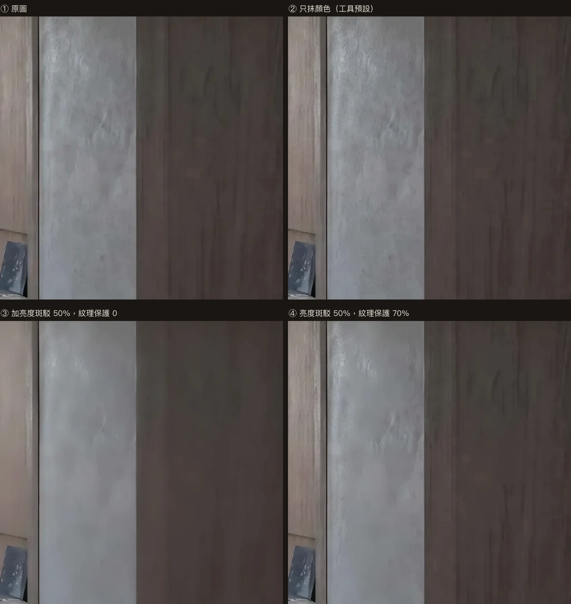

用 ChatGPT 或 GPT Image 生過圖的人，多半有過這種經驗：縮小看很漂亮，一放大，平整的牆面、天空、皮膚上長滿了東西。有時是一顆一顆的彩色細點，有時是一塊一塊的亮暗雲紋，像牆壁受潮留下的水漬。網路上有人叫它「炸掉的質感」（fried look），也有人說是「魚鱗皮」。

跟別家模型比起來，GPT 的圖這個毛病特別明顯。這篇用不需要數學的方式講三件事：這種「髒」到底是什麼、為什麼 GPT 特別嚴重、我們能做什麼。後半是本站〈[AI 圖片色雜訊診斷與降噪](/resource/ai-image-denoise/)〉這個工具的開發過程，當成一個實際案例：怎麼把一張人像臉上的雲紋洗乾淨，又不把毛孔、髮絲一起抹掉；最後再拿一張暗調的臥室圖，看看木紋怎麼保住。

> OpenAI 至今沒有公布這個雜訊的成因。文中的成因都是公開線索與推論，每一項都會標明證據有多強。資料查詢日為 2026 年 11 月 26 日。

## 一、先分清楚：「髒」其實有兩種

放大一張 GPT 的圖，看到的髒大致分成兩種：

- **色雜訊（顏色的髒）**：平整的地方冒出偏紅、偏綠、偏藍的細點或小色塊，像一面白牆被灑了極細的彩色粉筆灰。
- **亮度斑駁（明暗的髒）**：平整的地方一塊亮、一塊暗，形狀沒有規則，像雲、像水漬。顏色沒變，只是深淺不均。

這兩種髒的處理方法完全不同，所以第一步是把它們拆開來看。下圖是同一塊臉頰的三種看法：中間只留顏色（亮度一律拉平，顏色放大 4 倍），右邊只留明暗的起伏（也放大 4 倍）。

結果很清楚：這張圖的顏色幾乎是乾淨的，髒的是明暗。這不是個案。我們拿 GPT Image 2 和 Images 2.5 的生成圖去量，扣掉輪廓之後剩下的細碎起伏裡，亮度的幅度大約是顏色的 2 到 4 倍。

這件事很重要：**多數人覺得 GPT 的圖「髒」，主要是亮度斑駁，不是色雜訊。** 後面會看到，只抹顏色的話，數字會變漂亮，肉眼卻幾乎看不出差別。

## 二、為什麼 GPT 特別明顯：官方沒說，但有線索

### OpenAI 怎麼說

官方承認有問題，但沒有解釋原因：

- OpenAI 的 GPT Image 研究員 Boyuan Chen 在 2026 年 4、5 月間，多次在 X 上回覆網友，表示雜訊（spackled／sparkled）的 bug 正在修。這幾則回覆是 OpenAI 論壇的使用者整理轉貼的，我們沒能直接打開原貼文。
- 2026 年 9 月 9 日，OpenAI 的客服帳號在論壇回覆一則「畫質突然變差」的討論，說成因和修正都**還沒確認**，並請使用者提供同樣設定下的前後對照。
- 2026 年 9 月的 Images 2.5 發表文沒有提到雜訊，只寫了圖裡會繼續加入 C2PA 內容憑證和隱形浮水印。

所以下面這些都是推論。我們把線索分成三條。

### 線索一：它畫圖的方式跟別家不一樣

目前主流的圖像模型，例如 FLUX、Stable Diffusion，大多是「擴散模型」：從一張滿是雜訊的畫面開始，整張圖一起反覆擦掉雜訊，擦個幾十次才成形。整張圖每一處都被修正了很多遍，大片的平面通常收得很乾淨。這類模型常見的毛病反而是相反的：皮膚像塑膠、畫面太光滑。

GPT 的做法不一樣。OpenAI 在 2025 年 3 月發表 4o 圖像生成時，文章裡藏了一張白板照，寫著兩個做法：「建模壓縮過的表示」、「把 autoregressive（自迴歸）的模型接上一個強大的解碼器」，旁邊畫著 tokens → transformer → diffusion → pixels。這張白板只是示意，不是規格書，但方向很明確。另一篇學術評測 GPT-ImgEval 也用分類器測過，結論是它像「自迴歸模型加上擴散式的解碼頭」。

用比喻來說：GPT 不是直接畫像素，而是先用很少的「字」寫下一份這張圖的摘要，再交給解碼器，依摘要還原成像素。摘要裡沒寫到的細節，就由解碼器去補。

這份摘要有多短？論壇使用者整理的計價表裡，gpt-image-1 畫一張 1024×1024 的圖，低、中、高三種畫質的輸出 token 分別是 272、1056、4160 個。這三個數字剛好是 16×17、32×33、64×65，很像是 16×16、32×32、64×64 的格子，每一列再多一個分隔符號。如果真是這樣，高畫質時每個 token 要負責 16×16 個像素，低畫質時要負責 64×64 個像素。對照擴散模型常見的做法，同一張 1024×1024 的圖，是在 128×128 個位置上一起修正。（計價用的 token 不一定等於模型內部的格子，所以這只是線索。）

摘要越短，解碼器要補的就越多。一面灰牆在摘要裡大概只是「一面灰牆」，解碼器補出來的細節，就可能是原本不存在的紋路。這是目前最多人接受的推論，但沒有人證實過。

### 線索二：越改越髒

這一條的證據最扎實。2025 年 7 月起，OpenAI 論壇就有人回報：用 gpt-image-1 連續編輯同一張圖，把上一張的輸出當成下一張的輸入，改個幾次之後畫面就變得滿是顆粒、無法使用。後面跟了三十多則回覆，很多人遇到同樣的狀況。

原理可以想成 JPEG 反覆存檔：每編輯一次，圖就被「寫成摘要、再還原」一次，每一輪補出來的假細節，會被下一輪當成真的細節保留下來，再疊上新的。這解釋了「越改越髒」，但解釋不了「第一張就有」的那層底噪。

### 線索三：是浮水印嗎？

OpenAI 確實在圖裡加了看不見的浮水印。2026 年 5 月，X 上的帳號 @pleometric 貼出從 GPT Image 2 的圖裡抽出來的格狀圖樣，說放大來看，正是 GPT 圖那種「炸掉的質感」。貼文也提醒，這不代表所有尺寸、所有模式的浮水印都一樣。

這個說法目前沒有人證實。我們自己量過一件相關的事：如果雜訊來自固定的格子，它的能量會集中在固定的間距上。我們把 GPT Image 2 和 Images 2.5 的生成圖拆開，量 8、16、32 像素這些固定間距占了多少，結果只占細碎起伏的 1% 到 4%。格子確實存在，但大部分的斑駁不是規律重複的圖樣。所以就算浮水印是格狀的，它也解釋不了大部分的髒。

另外要說清楚：本站的工具不是用來去浮水印的，我們也沒有、不打算去測試它對隱形浮水印的影響。

### 小結

| 線索 | 證據 | 能解釋什麼 |
|---|---|---|
| 摘要＋解碼器補細節 | 官方白板、學術評測、token 數 | 第一張就有的底噪（推論） |
| 連續編輯累積 | 論壇大量回報 | 越改越髒（最確定） |
| 隱形浮水印 | 一位使用者的抽取 | 頂多一小部分（未證實） |
| 後段銳化 | 學術評測觀察到過度銳化 | 讓雜訊看起來更「脆」 |

至於別家：Google 的 Gemini（Nano Banana）和 Midjourney 都沒有公開架構，沒辦法用同一套邏輯比較。我們只能從量測看到結果上的差別，下一節會講。

## 三、怎麼量：把「髒」變成 1 到 5 級

「看起來髒」很主觀，所以工具做的第一件事是打分數。做法的重點有三個：只量平滑的地方（牆、天空、皮膚），因為有輪廓的地方顏色本來就會變；扣掉跟著明暗一起變的顏色，因為那通常是光影，不是雜訊；最後取中位數，不讓少數色彩鮮豔的區塊把分數拉高。

分數大約等於平滑區裡顏色起伏的色差，每升一級幅度加倍：1 級乾淨、2 級輕微、3 級明顯、4 級嚴重、5 級非常嚴重。門檻是用乾淨的圖加上已知幅度的人工色斑去校準的，再照肉眼看得見的程度定下來。

拿編輯部手邊的 318 張生成圖試過，GPT 的圖多數落在 2 級，Gemini 多數是 1 級，約 3% 到了 3 級。要注意，這個分數**只量顏色**。GPT 的圖色雜訊多半只是「輕微」，但看起來還是髒，因為髒的主要是亮度，也就是第一節說的那件事。

## 四、案例：把一張人像洗乾淨

下面這張是一張 AI 生成的人像，1125×2000 像素：白底、正面、黑色長直髮、駝色大衣、酒紅色高領毛衣。縮小看很乾淨，工具量出的色雜訊指數是 0.80，2 級（輕微）。可是把臉頰放大，平整的皮膚上就浮出一塊一塊的淡淡雲紋，也就是開頭說的「魚鱗皮」。

人像是最難處理的題材：臉頰要乾淨，毛孔、髮絲、衣料的質感卻都得留著，哪一處抹過頭，人看起來就假了。

### 第一步：只抹顏色

工具一開始只處理顏色。原理是拿明暗的輪廓當參考，把顏色在輪廓之內抹勻：顏色可以在同一片臉頰裡流動，但不會越過嘴唇、眼睛的邊界，所以嘴唇的粉紅不會滲到皮膚上。

這張圖的色雜訊指數從 0.80 降到 0.36，從 2 級降到 1 級。可是把前後兩張並排看（下面四格圖的①和②），幾乎看不出差別。量出來，臉頰上 2 到 25 像素大小的明暗紋路一點都沒少，因為那是明暗的髒，顏色濾鏡碰不到。

### 第二步：抹亮度，但不能蒙上一層霧

所以要處理亮度。直覺的做法是「把小的亮暗起伏壓平」，但第一版在一張暗調的圖上試，整張圖像蒙上一層霧，不清不楚。

量出來，霧感來自三件事一起發生：最黑的地方被抬亮、最亮的地方被壓暗、小範圍的對比少了大約三成。壓平斑駁的同時，畫面的黑白兩端也被一起往中間拉。

解法分三步：

1. **保邊的平滑**：只在亮度相近的像素之間平均，碰到明顯的邊就停。臉頰裡面會被抹平，臉頰和鼻翼、頭髮的交界不會。
2. **大的起伏留下**：拿原圖和平滑後的圖相減，差很多的地方是痣、睫毛、唇線這類真正的輪廓，原封不動；差一點點的才是斑駁，壓掉。
3. **亮度分布對回原圖**：把處理後每個像素亮度的「名次」對回原圖。原圖最暗的 1% 是多黑，處理後最暗的 1% 就一樣黑，亮部也一樣。整張圖的黑白層次不變，霧就沒了。

這就是工具的「亮度斑駁」。開到 50%，臉頰的雲紋只剩原來的 42%，痣和睫毛都還在（下面四格圖的④）。

### 第三步：太乾淨，像磨過皮

問題是④乾淨過頭了。皮膚本來就不是平的，有毛孔、有細小的起伏，大小只有一兩個像素。亮度斑駁分不出這層細顆粒和斑駁，只要起伏小就一起壓掉：開到 50% 時，臉頰的細顆粒也只剩 41%。結果正好是第二節說的擴散模型的毛病：皮膚像塑膠。

人像有另一個專用的做法：工具的「人像」開關，打開後是「膚色均勻」。它先把亮度輕輕模糊，兩個像素以下的毛孔、髮絲就不在裡面了；再只在膚色的範圍裡，從模糊後的圖找出對比低、中等大小的不均勻，從原圖扣掉。毛孔那層細節從頭到尾沒被碰過，眼睛、鼻孔、唇線這種有對比的邊緣也不動。

下表是同一塊臉頰在各種設定下還留下多少，原圖是 100%。雲紋那一欄越低越乾淨；細顆粒那一欄越高，皮膚的質感保住越多：

| 設定 | 雲紋（2–25 像素） | 細顆粒（1–2 像素） |
|---|---|---|
| 只抹顏色（工具預設） | 約 100% | 約 100% |
| 膚色均勻 40%（打開人像的預設） | 77% | 約 100% |
| 膚色均勻 70% | 61% | 約 100% |
| 亮度斑駁 30% | 66% | 67% |
| 亮度斑駁 50% | 42% | 41% |

膚色均勻 70% 和亮度斑駁 30% 去掉的雲紋差不多，但前者的細顆粒一點都沒少，後者少了三成。所以人像的臉先用膚色均勻；亮度斑駁留給牆、天空、背景這些沒有毛孔的地方。

### 第四步：髮絲要留著，靠方向

除了臉，亮度斑駁還會碰到頭髮。髮絲和斑駁的明暗起伏有時差不多大，光看「起伏有多大」分不開。它們的差別在**方向**：髮絲一條一條朝同一個方向；斑駁像天上的雲，一團一團，沒有方向。

所以工具會看每一小塊區域：這裡的明暗變化，是不是都朝同一個方向？越一致，就越像髮絲、木紋、布紋，處理時越接近原圖。再看大範圍：整片頭髮的方向是一致的，就讓整片連在一起受保護，不會這裡保護、那裡不保護。這就是「紋理保護」，預設 70%。

有個細節一定要先做：量方向之前，要先扣掉大範圍的明暗漸層。打光讓臉從鼻樑往耳朵慢慢變暗，天空從上到下慢慢變亮，這種漸層本身就是「有方向」的。不先扣掉，整張臉、整片天空都會被當成紋理保護起來，等於完全沒處理。

量出來，亮度斑駁 50% 時，頭髮的紋路不保護剩 91%，保護 70% 是 100%；眉毛從 94% 回到 100%。人像的髮絲對比高，就算不保護也只淡了一成。對比低的紋理就沒這麼幸運，後面的臥室圖會看到。

### 第五步：分不開的，交給使用的人

方向也不是萬能的。這張圖的駝色大衣（C 框）是毛呢料，表面是一團一團的細碎紋理，沒有方向，跟斑駁長得一樣。紋理保護判定它不用保護，亮度斑駁 50% 之後，毛料的紋路只剩 66%，看起來像麂皮；把紋理保護從 0 調到 100%，也只多留下幾個百分點。

駝色還有另一個麻煩：它太像膚色了，整件大衣都落在膚色均勻的範圍裡（工具的「膚色範圍」檢視看得到），膚色均勻 70% 時毛料剩 71%，40% 時剩 83%。

更根本的問題是：有些紋理是刻意的。毛呢、絨面、灰泥、微水泥本來就有這種一團一團的質感，工具分不出這是 AI 的瑕疵還是設計要的效果。

所以最後把決定交給使用的人：「亮度斑駁」預設是 0，也就是不動亮度，打開之後才出現「紋理保護」，預設 70%；「人像」預設關閉，打開後膚色均勻是 40%。以這張人像來說，打開人像、膚色均勻調到 70%、亮度斑駁維持 0，臉頰的雲紋剩六成，代價是大衣的毛料也淡了三成；在意大衣就留在 40%。每張圖的取捨不同，工具讓你放大比較。

### 換成場景：木紋比髮絲更容易被抹掉

同一套做法也用在場景上。下面是一張暗調的臥室圖（2000×1116 像素，八成以上的像素亮度不到三成），右側有灰泥牆和深色木門。木紋的對比低，和灰泥牆的雲紋差不多大，所以紋理保護在這裡的作用比在頭髮上明顯得多：不保護時木紋幾乎不見（③），保護 70% 就回來了（④）。

下表是亮度斑駁 50% 時，各處 2 到 25 像素的明暗紋路還留下多少（原圖是 100%）：

| 區域 | 不保護 | 保護 70% | 保護 100% |
|---|---|---|---|
| 木門 | 43% | 94% | 96% |
| 木地板亮處 | 67% | 82% | 89% |
| 木地板暗處 | 69% | 92% | 95% |
| 灰泥牆 | 47% | 72% | 80% |

木頭類幾乎都保住了，灰泥牆的斑駁仍去掉將近三成。場景也有分不開的地方：灰泥牆的方向一致性中位數約 0.20，木地板亮處約 0.27，兩者有一段重疊，沒有一個門檻能兩邊都顧到。想讓牆更乾淨就把保護調低，代價是木紋淡一些。

### 兩個沒有妥協的地方

- **圖片不上傳**：所有計算都在你的瀏覽器裡進行，載完頁面後斷網也能用。2K 的圖在一般電腦上，打開亮度斑駁約 1 秒算完。
- **預設不碰亮度**：亮度斑駁維持 0 的時候，輸出結果和加入這個功能之前逐位元相同（我們用 checksum 比對過）。已經習慣原本效果的人，不會在不知情的情況下被改掉。

## 五、工具做不到的

濾鏡只能降低斑駁的對比，不能讓它消失。原因很簡單：那些紋路是模型生成出來的內容，不是蓋在畫面上的一層雜訊，沒有一張「乾淨的原圖」可以還原。具體來說：

- **一兩個像素的細顆粒**：色雜訊和膚色均勻都故意不動它，抹掉它會連細節一起抹掉，畫面會變得像塑膠。亮度斑駁開得越強，細顆粒也會跟著變淡，所以臉請先用膚色均勻。
- **過度銳化的光暈、JPEG 的方塊、天空的色帶斷層**都不在處理範圍。
- **很暗的細輪廓會變淡**：暗部的明暗差距小，葉子貼在深色木條前時，可能被當成斑駁淡化。
- **沒有方向的質感會被當成斑駁**：毛呢、絨面、灰泥這種一團一團的紋理，紋理保護救不回來。
- **和膚色相近的東西會被當成皮膚**：駝色、米色的衣服，木頭、沙灘、夕陽，打開人像後都可能一起變平；不確定時，先切到「膚色範圍」檢視看看會動到哪裡。
- **有方向的 AI 瑕疵會被保護**：魚鱗狀、斜格狀的假紋理也有方向，紋理保護會把它們一起留下。
- **分數會誤判某些畫風**：水彩、做舊這種筆觸本身就帶顏色紋理，色雜訊指數會偏高；很暗、幾乎沒有平滑區的畫面，則可能無法判斷。

## 六、給創作者的建議：從源頭少一點髒

降噪是事後補救，能在生成端避開更好。以下依證據強弱排列：

- **不要在同一張圖上連續編輯。** 這是證據最強的一條。一發現圖變髒，就回到最後一張乾淨的圖，開新的對話重來，不要把髒的圖繼續當輸入。
- **要拿去當影片首幀的圖，先降噪再送。** 首幀就是影片的第一格，上面的斑駁會原封不動進到片子裡。@pleometric 也提到，帶浮水印的圖拿去餵 Wan 這類影片模型，會生出棋盤格狀的瑕疵（這是該帳號的觀察，未經證實）。
- **用 API 時選高畫質、輸出 PNG。** 高畫質的 token 多，摘要比較詳細；PNG 則排除了壓縮帶來的雜訊。這一條是推論，我們沒有實際量過差多少。
- **提示詞少用 hyper-detailed、8K、intricate 這類詞。** 這是社群流傳的經驗談，邏輯是這些詞會鼓勵模型在每個表面都長出細節；同樣沒有量測證據。

## 常見問題

**GPT Image 的雜訊是 bug 嗎？**

**答**：OpenAI 的研究員曾在 X 上表示正在修，但官方至今沒有公布成因，2026 年 9 月的客服回覆也說成因與修正都尚未確認。可以確定的是連續編輯會讓雜訊累積；第一張圖就有的底噪是怎麼來的，目前只有推論。

**用降噪工具會去掉 AI 標示或浮水印嗎？**

**答**：工具不是為此設計的，我們也沒有測試它對隱形浮水印的影響。工具存下的圖是重新產生的檔案，不含原檔的 EXIF 與 C2PA 內容憑證；作品要標示 AI 生成時，請照發布平台的規定另外標註。

**人像要用「膚色均勻」還是「亮度斑駁」？**

**答**：臉先用膚色均勻（打開「人像」）。它只動膚色範圍裡中等大小的不均勻，毛孔這種一兩個像素的質感不碰；亮度斑駁會連質感一起淡化，開太強會像磨過皮，比較適合牆面、天空和背景。兩者可以一起開，但駝色、米色的衣服可能被當成皮膚，請放大比較過再存檔。

**為什麼「亮度斑駁」預設不開？**

**答**：因為工具分不出哪些亮暗是 AI 的瑕疵、哪些是刻意的質感，例如灰泥、微水泥、毛呢；開得強時，皮膚細小的質感也會跟著變淡。預設只處理顏色，最不容易改壞畫面；亮度要你自己打開，放大比較過再決定。

**Gemini、Midjourney 生的圖也能用嗎？**

**答**：可以，工具不限定模型。依我們的量測，Gemini 的圖色雜訊多半只有 1 級，但有肉眼看不見的像素級細顆粒；工具的分數刻意在縮小後才量，避免把這種細顆粒算進去。

**手機上也能用嗎？**

**答**：可以，但手機的記憶體較少，4K 以上的圖可能處理不了，遇到時請先把圖縮小。

---

**資料來源**（擷取日 2026-11-26）

- OpenAI：[Introducing 4o Image Generation](https://openai.com/index/introducing-4o-image-generation/)（2025-03-25，白板內容）
- OpenAI：[Introducing ChatGPT Images 2.5](https://openai.com/index/introducing-chatgpt-images-2-5/)（C2PA 與隱形浮水印）
- OpenAI 論壇：[Image quality has all of a sudden degraded dramatically](https://community.openai.com/t/image-quality-has-all-of-a-sudden-degraded-dramatically/1379818)（2026-09-09 OpenAI_Support 回覆）
- OpenAI 論壇：[Collection of GPT image generator 2.0 issues, bugs and work-around tips](https://community.openai.com/t/collection-of-gpt-image-generator-2-0-issues-bugs-and-work-around-tips-check-first-post/1379535)（第 7 頁，2026-05-04 使用者整理 Boyuan Chen 的 X 回覆）
- OpenAI 論壇：[Multiple gpt-image-1 high fidelity edits lead to grainy result](https://community.openai.com/t/multiple-gpt-image-1-high-fidelity-edits-lead-to-grainy-result/1320474)（2025-07-20 起）
- OpenAI 論壇：[Gpt-image-1 collected pricing information](https://community.openai.com/t/gpt-image-1-collected-pricing-information-and-why-responses-is-undocumented/1275254)（輸出 token 數表）
- Yan et al.：[GPT-ImgEval: A Comprehensive Benchmark for Diagnosing GPT4o in Image Generation](https://arxiv.org/abs/2504.02782)（arXiv 2504.02782）
- Glitchwire：[X User Claims to Have Extracted GPT Image 2's Hidden Watermark](https://glitchwire.com/news/x-user-claims-to-have-extracted-gpt-image-2s-hidden-watermark-heres-what-that-me/)（@pleometric 的說法）
- K. He, J. Sun, X. Tang：Guided Image Filtering（ECCV 2010；工具抹顏色的方法）
- E. Gastal, M. Oliveira：Domain Transform for Edge-Aware Image and Video Processing（SIGGRAPH 2011；工具保邊平滑的方法）
- 量測數字（亮度與顏色起伏的比例、固定格子的能量占比、318 張圖的等級分布、兩張案例圖的紋路保留率）為編輯部以本站工具的程式碼實測。
